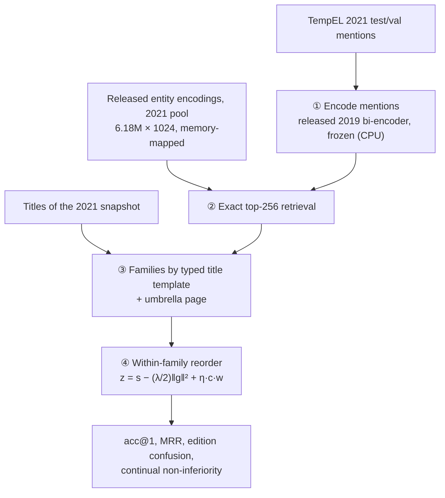

# Edition Confusion in Emerging-Entity Linking — Research Proposal with Early Results

**Benchmark:** TempEL (Zaporojets et al., NeurIPS 2022 D&B)
**Backbone:** TempEL's released 2019 BLINK bi-encoder and its released entity encodings for the 2021 snapshot. Both are used frozen. Nothing is trained on the TempEL side.
**Status (2026-11-15):** the reproduction, the error diagnosis (C2), the pre-registered test of the method (C3), the depth-256 table and the TIGER/BLINK re-scoring (C1, §6.5) are done. Only the hand audit is pending and marked **PENDING** below.

**Labels used in this document.** *Verified*: measured by us; the file that holds the number is named. *Reported*: quoted from a paper. *Inferred*: our reading, not measured. No performance predictions are made.

> **How this version differs from the previous one.** The previous version proposed removing a per-family shared subspace (knobs $\beta$, $k$). The design review showed that this term removes the directions in which siblings *differ*, and that for a family of two it equals a squared-norm penalty (checked numerically to 1e-13; record in `docs/ideas/review-round1.md`). The method is now a simpler within-family reorder (§3). The rules of the evaluation were committed to git (`12fd858`, 2026-11-07) **before** the test split was scored.

---

## 0. Summary

TempEL shows that newly emerging entities lose far more accuracy over time than continual ones (up to 17.9 vs 3.1 accuracy@64 points, reported). Its own manual analysis says about 90% of new entities are new members of an existing family: the next edition of a recurring event (~68%) or a page split off from an older one (~22%).

**Thesis.** For such entities the right page is often already in the candidate list but loses rank 1 to another *edition* of the same series ("2018 X" instead of "2020 X"). We call this **edition confusion**. It can be measured, and partly fixed, after retrieval, with no training.

**Three contributions, each tied to a published number:**

| | Contribution | Compared with | State |
|---|---|---|---|
| **C1** | First scores for TIGER and BLINK on **new-entity mentions only**. Their published "new entity" test set is 97% continual mentions (verified from their code and data). | TIGER/CYCLE Table 2 | Done (§6.5) |
| **C2** | A measured breakdown of *why* new entities fail on TempEL's full Wikipedia pool. | TempEL Table 2 (reproduced) | Done |
| **C3** | A training-free within-family reorder, judged by one pre-registered test against four controls. | Frozen TempEL model | Done |

**Headline results (all verified, TempEL 2019 model → 2021 test, full pool of 6,180,587 entities):**
- **Reproduction.** accuracy@64 is 0.7345 for new and 0.7673 for continual entities; TempEL Table 2 reports 0.734 and 0.767.
- **C2.** For recurring-event new entities, another edition or the series' parent page is at rank 1 for 18.7% of mentions, while the correct page is at rank 1 for 12.8%.
- **C3.** New-entity accuracy@1 rises from 0.174 to 0.210 (+3.6 points, 95% CI [+1.8, +5.6], p = 0.0001). Continual mentions that the method can reorder gain +2.5 points [+1.9, +3.2]. The pre-registered primary test and the non-inferiority test both pass.
- **On TempEL's own metric.** Re-ordering the top 256 lifts new-entity accuracy@64 from 0.7345 to 0.751 (+1.7 [+0.6, +3.0]); TempEL publishes 0.734. Continual accuracy@64 is unchanged (§6.4).
- **C1 (TIGER's protocol, our re-run of its public code).** Scored on new-entity mentions only, R@1 is 0.34–0.35 where the pooled figure is 0.19–0.20 (2019 models, 2022 test). The pooled figure is within 0.4 points of the continual-only figure. TIGER minus BLINK is +0.5 to +0.7 points pooled, and not distinguishable from zero on new-entity mentions in any test year (§6.5).

**The main caveat.** A one-line prior, "inside a family, prefer the 2020 edition", gains +3.2 points on new-entity accuracy@1, statistically the same as our method (+0.3 difference, not significant), and gains more than our method on accuracy@64 (0.764 vs 0.751). The reason is how TempEL is built: 81% of dated new gold pages are 2020 editions (verified). Our method differs from that prior on continual entities: the prior loses 0.3 points there and ours gains 2.5. The defensible claim is therefore **"the only tested rule that helps both populations"**, not "beats every baseline" (§6.3, §8).

**A second caveat, from TIGER's pool.** Applied to TIGER's and BLINK's lists with the knobs unchanged, the method gains +0.4 to +2.2 points on new-entity R@1 and +2.0 to +2.2 on continual R@1. But there a plain title-matcher control, which re-sorts the whole list, gains far more (+5 to +12 new, about +5 continual). On TempEL's full pool the order was the reverse. We report both (§6.5.2).

---

## 1. Motivation: what TempEL shows

### 1.1 The dataset

TempEL is built from 10 yearly English-Wikipedia snapshots, 2013–2022 (reported, TempEL §3).

| Per snapshot (TempEL Table 1) | Train | Val | Test |
|---|---|---|---|
| Continual entities | 10,000 | 10,000 | 10,000 |
| Continual-entity mentions | 136,227 | 42,096 | 46,765 |
| New entities | 373 | 373 | 373 |
| New-entity mentions | 1,764 | 1,231 | 1,450 |

The model is a BLINK bi-encoder on BERT-large (TempEL footnote 6) that retrieves from the whole snapshot. The published metric is accuracy@64.

### 1.2 Findings that motivate this work

| # | Finding (TempEL paper, reported) | What it tells us |
|---|---|---|
| F1 | Over time, continual entities lose **up to 3.1** accuracy@64 points; new entities lose **up to 17.9**. | Temporal degradation hits emerging entities hardest. |
| F2 | In a manual check of 100 new entities, **~68%** were recurring events and **~22%** were extracts of existing pages. | About 90% of new entities are born into an **existing family**. |
| F3 | In 2021, COVID-19 entities are **24%** of new entities and **30%** of their mentions, with an extra **~14**-point penalty. | A second population that needs **new world knowledge**. Our method does not address it (§8). |
| F4 | Continual-entity changes are **accumulative**. | A re-ranker must not break continual entities. |
| F5 | The Jaccard similarity between top-64 candidates **rises every year** (Fig. 4a, 4c). | Candidate lists get more crowded with look-alikes. |

TempEL's appendix (Fig. 8) guesses that near-identical editions cause the "recurrent" failures but does not measure it. C2 measures it.

### 1.3 What existing fixes leave open

- **TIGER / CYCLE** shape the embedding space with graphs during training. Their published "new entities" R@1 at a 3-year gap: BLINK 0.142, TIGER 0.217, CYCLE 0.222 (reported, TIGER/CYCLE Table 2).
  - **Their test set is pooled** (verified in TIGER's code, `src/tiger/evaluate.py`, and data): the "new entities" columns come from models *trained* on 1,764 new-entity mentions and *tested* on 46,765 continual + 1,450 new mentions. So 97% of the test mentions are continual.
  - **Their pool is small**: 10,373 entities, against 6.18M in TempEL's own evaluation (verified).
  - **Gap 3 is a single train/test pair**, 2019 → 2022 (verified from the supplementary tables).
  - The public CYCLE repository cannot run (`src/cycle/models/` is missing; verified 2026-11-06). CYCLE is quoted, not re-run.
- **RAED** generates entity descriptions with retrieval and helps genuinely novel entities (emerging accuracy@64 57.0 / 47.4 / 53.5 for the 2019 model on 2020/21/22; reported, RAED Table 3). Its Jan 2023 index is not temporally sound, and it reports accuracy@64 only, so we make no numeric comparison with it.

No prior work reports **where in the ranking** new entities fail, or a score on new-entity mentions alone for the graph-based linkers.

---

## 2. Problem statement

**Task.** Input: a mention with context, observed in snapshot $t$, and the candidate list: the top-$K$ entities from $\mathrm{KB}(t)$ under TempEL's frozen bi-encoder ($K = 64$; $K = 256$ in §6.4). Output: a re-ordering of that list. Closed world, as in TempEL. Nothing dated after $t$ is used.

| | Population | Role |
|---|---|---|
| **P1** | Continual entities | **Must not regress**; reported in every table |
| **P2** | New members of a family (recurring events, page extracts) | **Main target** |
| **P3** | Genuinely novel entities (COVID-19) | Reported as a separate slice; not addressed |

**Research questions.**
- **RQ1 (diagnosis).** What share of new-entity errors are retrieval misses, edition confusions, or other ranking errors?
- **RQ2 (method).** Does a training-free within-family reorder raise new-entity accuracy@1 over the frozen model, and over simple priors that exploit the benchmark's construction?
- **RQ3 (safety).** Does it leave continual entities at least as accurate?

---

## 3. The method

Everything below uses only the frozen candidate list, its scores, the released entity vectors, the titles of snapshot $t$, and the 128 tokens the encoder itself saw. Code: `code/families.py`, `code/rerank.py`.

**Step 1: typed slots.** A title word is a *slot* if it is a year, a season ("2019–20"), an ordinal ("23rd"), a plain number, a strict Roman numeral of two or more letters, or a number word. Words that mix letters and digits ("COVID-19", "F-16") are never slots. Replacing slots by `#` gives the title's **template**: "2022 FIFA World Cup" → "# FIFA World Cup".

**Step 2: families inside the list.** Candidates with the same template and slot types form a family. The **umbrella page** (the template without its slot, "FIFA World Cup") joins it. Families that share a member are merged. A family needs at least two members, one of them slotted.

**Step 3: slot evidence.** For a slotted candidate $e$, the evidence $w(e) \in [0, 1]$ says whether its slot value appears in the encoder window:
- 1 if the exact typed value occurs inside the mention span; ½ if it occurs elsewhere in the window;
- a bare year that is only one endpoint of a season counts half;
- non-year slots count only inside the mention span; the umbrella page has $w = 0$.

**Step 4: score.**

$$
z(e) = s(e) - \tfrac{\lambda}{2}\,\lVert g_e \rVert^2 + \eta \, c \, w(e)
$$

Here $s$ is the frozen dot-product score and $g_e$ the entity vector. $\lambda = 1$ ranks a family by Euclidean distance instead of dot product. $c$ is the median gap between the first and second score on validation (2.10; it needs no labels) and only sets the unit of $\eta$.

**Step 5: ordering.** Each family refills **exactly the list positions it already holds**, sorted by $z$. Candidates outside a family never move.

**Guarantees, asserted in code on every configuration:**
1. Non-family candidates keep their positions.
2. accuracy@$K$ at the list depth cannot change.
3. Any change in accuracy@1 is a sibling swap: fixed minus created edition confusions.
4. $\lambda = \eta = 0$ reproduces the frozen list exactly.

**Tuned knobs:** $\eta \in \{0, 0.5, 1, 2, 4, \infty\}$ and $\lambda \in \{0, 0.25, 0.5, 1\}$, on validation only. The selection on every fold was $\eta = \infty$, $\lambda = 0.5$: inside a family, candidates whose slot is supported by the context come first, and the corrected score breaks ties (`data/enc/knobs_d64.json`).

### 3.1 How this differs from nearby work

| Work | Difference |
|---|---|
| TIGER / CYCLE | They train entity embeddings with graphs. We change only the order of an existing list, with no training. |
| RAED | Adds knowledge for novel entities. Ours separates look-alike editions. Complementary. |
| Cross-encoder re-ranking (BLINK) | Needs a trained cross-encoder. Ours needs none. |
| A plain "year in context" rule | That is our title-matcher control, which sorts the whole list. It gains +1.0 on new entities; the family-restricted version gains +3.6 (§6.3). |

---

## 4. Pipeline

Steps ① and ② ran once and are cached. Steps ③ and ④ take minutes on a laptop CPU.

---

## 5. Evaluation protocol

### 5.1 Pre-registration (git `12fd858`, before any test scoring)

1. **Data:** TempEL 2021 test, 2019 model, full pool, top-64; all 1,450 new and 46,765 continual mentions.
2. **Primary test:** change in new-entity accuracy@1, our method minus frozen; entity-level sign-flip permutation, 10,000 permutations, two-sided $\alpha = 0.05$.
3. **Non-inferiority:** on continual mentions whose rank-1 candidate lies in a family ("changeable"), the 95% entity-bootstrap lower bound of the change must be $\ge -1.0$ point.
4. **Cross-fitting:** validation and test share every entity, so knobs are chosen in 5 folds grouped by gold template; a mention in fold $k$ is scored with knobs chosen on the other folds' validation data. Selection rule: maximise new-entity accuracy@1 subject to a changeable-continual change $\ge -0.5$ point; ties go to the smaller $\eta$, then the smaller $\lambda$.
5. **Secondary tests (Holm-corrected):** our method against each control on all new mentions and on two subsets (below).
6. **One test pass per row.** Anything later is labelled exploratory.

### 5.2 Controls

All use the same within-family ordering unless stated, and each was tuned on validation by the same rule.

| Control | What it tests |
|---|---|
| **Recency prior**: prefer the largest slot value in the family | Is the gain just "pick the newest edition"? |
| **Snapshot-year prior**: prefer editions dated 2020 | Is the gain just the benchmark's construction year? |
| **Placebo**: slot evidence taken from the context of a *different entity's* mention | Does the mention's own context matter? |
| **Title-matcher**: slot evidence applied to the whole list, no families | Do families matter? |
| **$\lambda$-only**, **$\eta$-only** | Which term carries the effect? |

**Subsets.** *Gold-not-latest*: the gold is in a family and is not its newest member (115 new test mentions). *Dated non-2020*: the gold title carries a year other than 2020 (105).

### 5.3 Statistics and temporal protocol

- There are only 373 new entities, so intervals are 95% bootstrap CIs **resampling entities, not mentions**, and tests are paired.
- Everything used at test time is dated $\le t$ = 2021-01-01: the pool, the titles, the released encodings. The backbone is BERT-large pretrained on 2018 Wikipedia. **No LLM is used.**

---

## 6. Results

All numbers in this section are verified. Files are in `data/enc/` (not in git; regenerate with the commands in `code/`).

### 6.1 Reproduction of TempEL (2019 model → 2021 test, full pool)

| accuracy@64 | Ours | TempEL Table 2 (reported) |
|---|---|---|
| New entities (1,450 mentions) | 0.7345 | 0.734 |
| Continual entities (46,765 mentions) | 0.7673 | 0.767 |

TempEL reports accuracy@64 only. From the same run, the frozen model's accuracy@1 is **0.1738** for new and **0.2117** for continual entities, and accuracy@256 is 0.8566 and 0.8625 (`test2021full.log`).

### 6.2 C2: why new entities fail (frozen model, test)

Each mention falls in exactly one column. "Edition confusion" means the rank-1 candidate is in the gold's family (another edition, or the umbrella page). Slices are TempEL's own filter types.

| | n | Correct @1 | Edition confusion @1 | Other error, gold in top-64 | Miss, a sibling in top-64 | Miss, no sibling | Ceiling of perfect within-family reorder (acc@1) |
|---|---|---|---|---|---|---|---|
| New: recurrent | 561 | 12.8% | **18.7%** | 48.0% | 10.5% | 10.0% | 0.316 |
| New: COVID | 440 | 17.0% | 0.0% | 45.2% | 0.0% | **37.7%** | 0.171 |
| New: other | 449 | 23.4% | 3.6% | 49.9% | 2.2% | 20.9% | 0.270 |
| **New: all** | 1,450 | 17.4% | 8.3% | 47.7% | 4.8% | 21.8% | **0.257** |
| Continual | 46,765 | 21.2% | 2.8% | 52.8% | 1.6% | 21.7% | 0.240 |

Source: `test2021full.diagnose.log`.

- **Recurrent new entities:** a wrong edition wins rank 1 more often than the right page does. Validation shows the same pattern (22.9% vs 9.8%).
- **COVID new entities:** no edition confusion at all; the dominant failure is that the gold is not retrieved. A reorder cannot help this population.
- **Headroom:** a perfect within-family reorder would lift new-entity accuracy@1 from 0.174 to 0.257. About half of all errors are neither misses nor edition confusions, and are outside this method's reach.
- **Hand audit: PENDING.** 100 seeded errors are in `data/audit/audit_sheet.csv` for blind labelling; agreement with the automatic bucket will be reported.

### 6.3 C3: the pre-registered test (depth 64)

| Row | New acc@1 | Δ vs frozen [95% CI] | New MRR | New edition confusion @1 | Fixed / created (new) | Δ changeable continual (n = 10,111) [95% CI] | Continual acc@1 |
|---|---|---|---|---|---|---|---|
| Frozen TempEL | 0.1738 | — | 0.274 | 8.3% | — | — | 0.2117 |
| Recency prior | 0.1807 | +0.7 [+0.1, +1.3] | 0.287 | 7.7% | 13 / 3 | −0.2 [−0.4, −0.1] | 0.2113 |
| Snapshot-year prior | 0.2062 | +3.2 [+1.8, +4.9] | 0.319 | 5.1% | 47 / 0 | **−0.3 [−0.4, −0.1]** | 0.2111 |
| Placebo | 0.1710 | −0.3 [−0.7, +0.1] | 0.274 | 8.6% | 2 / 6 | −0.3 [−0.6, +0.1] | 0.2111 |
| Title-matcher (whole list) | 0.1834 | +1.0 [+0.1, +2.0] | 0.287 | 7.7% | 23 / 9 | +2.4 [+1.9, +3.0] | 0.2192 |
| $\lambda$-only | 0.1724 | −0.1 [−0.6, +0.2] | 0.275 | 8.5% | 3 / 5 | +0.0 [−0.3, +0.3] | 0.2118 |
| $\eta$-only | 0.2034 | +3.0 [+1.5, +4.6] | 0.311 | 5.4% | 43 / 0 | +2.7 [+2.1, +3.4] | 0.2176 |
| **Ours** | **0.2097** | **+3.6 [+1.8, +5.6]** | **0.317** | **4.8%** | **52 / 0** | **+2.5 [+1.9, +3.2]** | 0.2172 |
| Ceiling (perfect reorder) | 0.2572 | +8.3 | | | | | |

Source: `test2021full.results_d64.json`, git `12fd858`. accuracy@64 is 0.7345 in every row, as guaranteed.

**Against the pre-registered rules:**
- **Primary test: passed.** +3.6 points, p = 0.0001.
- **Non-inferiority: passed.** The lower bound on changeable continual mentions is +1.9, against a limit of −1.0.
- **On continual entities the method does create errors**: 424 fixed against 168 created (46 of them demote a correct umbrella page). The net is positive, but "creates no errors" holds for new entities only.

**Secondary tests, our method minus each control (Holm-corrected over 12 tests):**

| Against | All new (n = 1,450) | Gold-not-latest (n = 115) | Dated non-2020 (n = 105) |
|---|---|---|---|
| Recency prior | **+2.9 [+1.4, +4.5], p = 0.001** | +6.1 [+2.2, +11.4], p = 0.11 | +1.0, n.s. |
| Snapshot-year prior | +0.3 [−1.4, +2.2], n.s. | +0.0, n.s. | +1.0, n.s. |
| Placebo | **+3.9 [+2.1, +5.9], p = 0.001** | +6.1 [+2.3, +11.0], p = 0.13 | +1.0, n.s. |
| Title-matcher | **+2.6 [+1.0, +4.4], p = 0.02** | +0.9, n.s. | −1.0, n.s. |

Source: `test2021full.secondary_d64.json`.

**Reading the result.**
- The mention's own context matters (placebo: no gain), families matter (the title-matcher gains a third as much on new entities), and the effect is carried by the slot evidence; the norm term $\lambda$ adds +0.6 on top of $\eta$-only, which was not tested for significance.
- **Our method does not beat the snapshot-year prior on new entities.** TempEL's new entities are, by construction, pages created in the last year, and 81% of dated new gold titles are 2020 editions. A prior that knows the snapshot year captures most of the available gain.
- **It does differ on continual entities** (descriptive, not pre-registered): ours minus the snapshot-year prior on changeable continual mentions is +2.8 points [+2.1, +3.5]. The prior uses no context, so it wrongly prefers 2020 editions for older mentions; ours reads the year from the context.
- **The test gain is smaller than the validation gain** (+3.6 vs +6.4 cross-fitted). Both subsets where the newest edition is wrong are small (about 100 mentions), and no subset result survives the multiple-test correction.

### 6.4 Depth 256: can a reorder change accuracy@64?

Re-ordering the top-64 cannot change accuracy@64. Re-ordering the **top-256** can, and accuracy@64 is the metric TempEL publishes. The depth-64 knobs were applied unchanged to the top-256 lists, in one pass.

| accuracy@64, test | New (n = 1,450) | Δ vs frozen [95% CI] | Continual (n = 46,765) | Δ vs frozen [95% CI] |
|---|---|---|---|---|
| TempEL Table 2 (reported) | 0.734 | | 0.767 | |
| Frozen (ours) | 0.7345 | — | 0.7673 | — |
| Recency prior | 0.7441 | +1.0 [+0.2, +1.8] | 0.7669 | −0.04 [−0.07, −0.01] |
| **Snapshot-year prior** | **0.7641** | **+3.0 [+1.4, +5.0]** | 0.7667 | −0.06 [−0.10, −0.04] |
| Title-matcher (whole list) | 0.7386 | +0.4 [−0.3, +1.2] | 0.7695 | +0.21 [+0.12, +0.31] |
| **Ours** | **0.7510** | **+1.7 [+0.6, +3.0], p = 0.002** | 0.7677 | +0.04 [−0.05, +0.12] |
| Ceiling (perfect reorder) | 0.7717 | +3.7 | 0.7787 | +1.1 |

Source: `test2021full.t3_d256.json` (`code/t3_depth256.py`). accuracy@256 is 0.8566 / 0.8625 in every row. accuracy@1 at depth 256 equals the depth-64 value for our method (0.2097 new, 0.2171 continual).

- **Our method is above TempEL's published accuracy@64 for new entities** (0.751 vs 0.734) with continual entities unchanged.
- **The snapshot-year prior is higher still on new entities** (0.764). At this metric the benchmark's recency artifact outweighs the context evidence: an edition dated 2020 is pulled into the top 64 even when the context does not state the year. The prior again costs continual entities a small but significant amount; ours does not.

### 6.5 C1: TIGER and BLINK on new-entity mentions only

All numbers in this section are *verified*: `data/kaggle/c1_results.json`, `c1_table.txt` and `tiger_b.json`, produced by `code/kaggle_c1.sh` (Kaggle T4) and `code/tiger_b.py` (laptop). Published numbers are *reported* from TIGER/CYCLE Table 2.

**Setup.** TIGER's own code at commit `649bb19`, its released data (Zenodo 10977757) and its own configs: `baseline.yaml` (BLINK) and `paper.yaml` (TIGER), seed 52313, 1 epoch. Trained on {new, continual} mentions × years 2019–2022 = 16 models, each tested forward to 2022 on TIGER's pool of 10,373 entities. One seed. A first run that stopped at the 16th model agrees with the second on 43 of the 46 pooled R@1 values they share, to four decimals; the other three (one model) differ by at most 0.0004.

#### 6.5.1 The re-scoring (C1)

R@1, models trained on new-entity mentions, mean over train/test pairs with the same forward gap (the papers' convention). Test set: 48,215 mentions = 1,450 new + 46,765 continual.

| | Scored on | Gap 0 | Gap 1 | Gap 2 | Gap 3 |
|---|---|---|---|---|---|
| BLINK, published | pooled | .132 | .132 | .132 | .142 |
| BLINK, our re-run | pooled | .204 | .203 | .193 | .193 |
| | **new only** | **.323** | **.296** | **.297** | **.343** |
| | continual only | .201 | .200 | .190 | .189 |
| TIGER, published | pooled | .186 | .195 | .188 | .217 |
| TIGER, our re-run | pooled | .204 | .202 | .196 | .199 |
| | **new only** | **.333** | **.311** | **.329** | **.349** |
| | continual only | .200 | .199 | .192 | .195 |
| CYCLE, published (code not runnable) | pooled | .184 | .191 | .192 | .222 |

- **The pooled score is the continual score.** In the table the two differ by at most 0.4 points (at most 0.6 in any single train/test pair). The published "new entity" column therefore describes how a model *trained* on new-entity mentions does on continual mentions.
- **On new-entity mentions alone, R@1 is 10 to 15 points higher** than the pooled figure (0.30–0.35 against 0.19–0.20).
- **Training on new-entity mentions shows no advantage on new-entity mentions.** BLINK trained on continual mentions scores .304 / .296 / .300 / .332 on new-only (gaps 0–3), about the same as the new-trained row, and .33–.34 on continual mentions. (Descriptive; no interval computed.)
- **The published BLINK-to-TIGER gap does not reproduce in our re-run.** Our BLINK re-run is 5 to 7 points above the published BLINK row; our TIGER re-run is within 2 points of the published TIGER row.

TIGER minus BLINK on the same mentions (2019 models, entity-level bootstrap, 95% CI, points of R@1):

| Test year | Pooled | New only (n = 1,450) | Continual only |
|---|---|---|---|
| 2019 | +0.7 [+0.3, +1.1] | +0.7 [−2.6, +4.0] | +0.7 [+0.3, +1.1] |
| 2020 | +0.7 [+0.3, +1.1] | −0.7 [−4.3, +2.8] | +0.8 [+0.4, +1.2] |
| 2021 | +0.5 [+0.2, +0.9] | −1.9 [−4.9, +0.9] | +0.6 [+0.2, +1.0] |
| 2022 | +0.6 [+0.2, +1.0] | +0.5 [−2.6, +3.8] | +0.6 [+0.2, +1.0] |

TIGER's gain in our re-run is real but under one point, and it sits on continual mentions. On new-entity mentions the difference cannot be told from zero with 1,450 mentions. **What this does not show:** that TIGER's paper is wrong. We ran one seed of a 2026 re-release of the code on different hardware, and the larger mismatch is in the BLINK baseline row.

*Titles in the eval pool.* TIGER's default pool encodes descriptions without titles. Adding titles (`use_title_in_pool`) lifts 2022 pooled R@1 from .193 to .208 (BLINK) and .199 to .211 (TIGER), and new-only from .343 to .386 and .349 to .389.

#### 6.5.2 The method on TIGER's and BLINK's lists

The method of §3 was applied to the top-64 lists of the 2019 new-trained models **with the knobs chosen on TempEL unchanged** ($\eta = \infty$, $\lambda = 0.5$). Only $c$ is re-estimated, label-free, from each model's own validation lists (0.774 for BLINK, 0.839 for TIGER). Control rows also keep their TempEL knobs. One pass; `code/tiger_b.py` refuses to overwrite its output. Pool without titles (the papers' protocol).

| Model, test year | New R@1 frozen | Oracle | Ours | Snapshot-year prior | Title-matcher | Continual R@1: frozen → ours → title-matcher |
|---|---|---|---|---|---|---|
| BLINK, 2021 | .309 | .321 | +0.4 [−0.2, +1.1] | +0.3 [−0.6, +1.2] | +5.2 [+3.4, +7.5] | .192 → .212 → .240 |
| TIGER, 2021 | .290 | .307 | +1.0 [+0.2, +2.0] | +0.8 [+0.1, +1.5] | +6.9 [+4.7, +9.3] | .198 → .219 → .247 |
| BLINK, 2022 | .343 | .381 | +2.1 [+0.9, +3.5] | +2.0 [+0.9, +3.3] | +9.8 [+7.4, +12.3] | .189 → .209 → .235 |
| TIGER, 2022 | .349 | .383 | +2.2 [+1.1, +3.7] | +1.3 [+0.4, +2.4] | +12.0 [+9.2, +15.0] | .195 → .215 → .244 |

Deltas are points of new-entity R@1 with 95% CIs. Test years 2019 and 2020 and the pool-with-titles runs are in `tiger_b.json` and show the same pattern.

- **The method transfers.** New-entity R@1 rises in all eight model-year cells (+0.4 to +2.2); seven of the eight intervals exclude zero. It created at most 3 new-entity errors per cell.
- **Most of its effect here is on continual mentions.** Continual R@1 rises by 2.0 to 2.2 points in every cell; on the continual mentions it can reorder (about 7,400) the gain is +12.3 to +14.0 points.
- **The room on new entities is small**, as expected from the pool: the gold page sits in an in-list family for only 13–22% of new mentions, and a perfect within-family reorder would add 1.2 to 3.8 points.
- **The title-matcher control beats the method on this pool, by a wide margin.** It re-sorts the whole list by whether a candidate's title slot (a year, a season, an ordinal) appears in the context, with no families. On TempEL's full pool the same control gained +1.0 on new entities against the method's +3.6 (§6.3). *Inferred, not tested:* in a pool of 10,373 pages that are all test answers, a page whose year appears in the context is rarely a distractor; among 6.18 million pages it often is, and the family restriction is what protects the ranking.
- **What we claim from this table:** the method is safe and helps on a second, independently trained pair of models without re-tuning. **What we do not claim:** that it is the best post-retrieval rule under TIGER's protocol. It is not.
- **A caution about the small pool.** A training-free title match adds 5 to 12 points of new-entity R@1 and about 5 points of continual R@1 here, several times the TIGER-minus-BLINK difference in our re-run. Scores on this pool are very sensitive to surface title cues.

---

## 7. Comparability map

| Our number | Compared with | Kind of comparison |
|---|---|---|
| Frozen accuracy@64, new / continual | TempEL Table 2: 0.734 / 0.767 | Reproduction, same model, pool and data (matched) |
| Method vs frozen, accuracy@1 and MRR | Our reproduced TempEL baseline | Paired, same lists |
| Method vs frozen, accuracy@64 at depth 256 | TempEL Table 2: 0.734 / 0.767 | Same metric as published: 0.751 / 0.768 |
| TIGER / BLINK re-run, pooled R@1 | TIGER/CYCLE Table 2 | Reproduction check, same code, data and protocol: TIGER within 2 points, BLINK 5–7 points above the published row (§6.5.1) |
| TIGER / BLINK, new-only and continual-only R@1 | — | New numbers; no published counterpart (§6.5.1) |
| Method on TIGER's and BLINK's lists | Our re-run of each model | Paired, same lists, knobs unchanged (§6.5.2) |
| RAED | — | Not compared: different index and metric |

---

## 8. Limitations and claims we do not make

- **Not claimed:** "state of the art"; "beats TIGER/CYCLE"; "TIGER/CYCLE are wrong"; "better than TempEL at accuracy@64 at depth 64" (impossible by construction); any numeric comparison with RAED.
- **The snapshot-year prior ties the method on new-entity accuracy@1 and beats it on accuracy@64** (§6.3, §6.4). Part of what looks like edition confusion on TempEL is a recency artifact of how its new entities are sampled.
- **COVID / novel entities are not helped.** They have no editions, and 37.7% of their mentions miss retrieval entirely.
- **One cell on TempEL's full pool.** The pre-registered results are for the 2019 model on the 2021 snapshot. Other years are tested only on TIGER's small pool (§6.5.2).
- **On TIGER's pool a plain title matcher beats the method** (§6.5.2). The method's advantage over that control is specific to the large pool.
- **The TIGER/BLINK re-run is one seed** of a re-released codebase. It does not establish that the published numbers are wrong.
- **Title templates only.** Page extracts whose titles share no template form no family and are not touched.
- **Small subsets.** The two subsets that separate the method from recency have about 100 mentions each.
- **The ceiling is low.** Even a perfect within-family reorder reaches 0.257 accuracy@1; about half of all errors are other ranking errors.

---

## 9. Compute actually used

| Item | Measured |
|---|---|
| Machine | Laptop, Ryzen 7 7730U, 15 GB RAM, no GPU |
| Downloads | 2019 model 2.68 GB; 2021 encoding table 25.3 GB (one file); tokenized 2021 test and validation; 2021 page info 0.53 GB |
| Mention encoding | 48,215 test mentions in about 3 h 10 min on CPU |
| Exact top-256 retrieval over 6.18M × 1024 | about 55 min, memory-mapped |
| Entity-norm pass | 127 s |
| Family features, tuning, test | minutes |
| Training | **None** on the TempEL side. C1 trains TIGER's 16 small models on a free Kaggle T4: about 2.6 h per full run (two runs; the first hit the 20 GB output cap). |
| Method on TIGER's lists (16 model-year sets) | about 10 min on the laptop |

---

## 10. Remaining work before Nov 20

1. **Hand audit** of 100 errors (§6.2).
2. Done since the last version: C1 on Kaggle and the TIGER ± method table (§6.5).
3. Dropped for time: BM25 re-rank row, the cross-encoder comparison, the exploratory "edition subspace" row.

## 11. Future work

1. Other train/test cells (2019 → 2020, 2022) and the in-snapshot diagonal.
2. A retrieval-side fix for the misses that have a sibling in the list (10.5% of recurrent new mentions).
3. Routing novel entities (COVID) to a RAED-style knowledge branch with a temporally sound index.
4. A trained cross-encoder as an upper-bound re-ranker, with and without the family reorder.
5. Fine-tuning with sibling hard negatives.

## 12. References

- Zaporojets et al. *TempEL: Linking Dynamically Evolving and Newly Emerging Entities.* NeurIPS 2022 Datasets & Benchmarks. — `Papers/`; code, models and encodings: https://github.com/klimzaporojets/TempEL
- Zhang, Cao, Groth. *TIGER: Temporally Improved Graph Entity Linker.* ECAI 2024. — `Papers/`; code: https://github.com/pengyu-zhang/TIGER-Temporally-Improved-Graph-Entity-Linker (commit `649bb19`)
- Zhang et al. *CYCLE: cross-year graph contrastive learning for temporal EL.* CIKM 2024. (not in `Papers/`)
- Ghonim et al. *RAED: Retrieval-Augmented Entity Description Generation for Emerging Entity Linking and Disambiguation.* EMNLP 2025. — `Papers/`
- Wu et al. *BLINK: Scalable Zero-shot Entity Linking with Dense Entity Retrieval.* EMNLP 2020.
