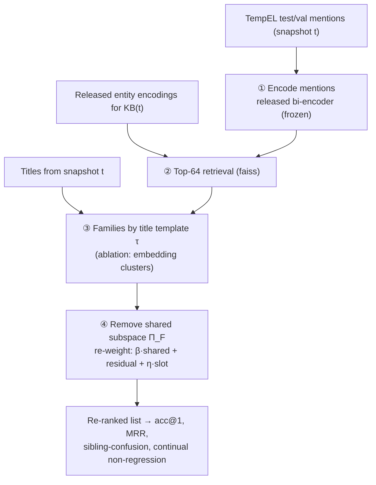

# Family-Relative Re-ranking for Emerging Entities — Research Proposal (scoped)

**Benchmark:** TempEL (Zaporojets et al., NeurIPS 2022 D&B)
**Backbone:** TempEL's released BLINK bi-encoders and their released entity encodings. We use them frozen and do **not** retrain them.
**Status:** scoped working design. No implementation yet, and no performance estimates. Every number below is quoted from a paper or the TempEL repository, and the source is given. Compute figures in §7 are **estimates to be measured**, not results.

> **What changed from the previous version, and why.** The evaluation panel judged the earlier design (graph family induction over Wikidata history, TIGER retraining, a RAED knowledge branch, a router, and NIL) **not feasible with the compute available**. Their advice was to scope it to something that produces results. This version keeps the one claim the evidence supports most directly, *family-relative scoring*, and builds it as a **training-free re-ranker on top of released, precomputed models**. Everything that needs training, LLM generation, or Wikidata history moves to §9 (future work). The earlier full design is in git history (`880fa5d`, plus later uncommitted edits).

---

## 0. Summary

TempEL shows that newly emerging entities lose far more accuracy over time than continual ones (up to 17.9 vs 3.1 accuracy@64 points). TempEL's own manual analysis also shows that roughly 90% of these new entities are **new members of a family that already exists**: the next edition of a recurring event (~68%), or a page split off from an older one (~22%). What identifies such an entity is a small **residual** (a year, an edition number, a host) inside a large block of content its siblings share.

> **Thesis.** When the right entity is already in the candidate list but loses to a sibling, the fix is to score candidates by *what distinguishes them from their family*, not by one global dot product. This can be done **after retrieval, with no training**, using only the snapshot's own titles and the released embeddings.

**The project in one line:** take the top-64 candidates that TempEL's released bi-encoder already returns, group them into families by title template, remove the subspace each family shares, and re-rank by the residual.

**Why this is feasible.** TempEL releases (a) the dataset, (b) the 10 trained bi-encoders, and (c) the precomputed entity encodings for every model × snapshot pair (README, `klimzaporojets/TempEL`; all four share links returned HTTP 200 on 2026-10-19). Training those models took 4 V100 GPUs (README), and **we skip that step entirely.** What is left is encoding about 90k mentions per snapshot, one nearest-neighbour search, and linear algebra on 64 × 1024 matrices per mention (§7).

**Guaranteed deliverable.** Phase 2 (§6.1) produces the first published breakdown of *why* emerging entities fail on TempEL: retrieval misses vs within-family confusion vs other errors. That result stands whether or not the re-ranker helps.

---

## 1. Motivation: what TempEL shows

### 1.1 The dataset

TempEL is built from 10 yearly English-Wikipedia snapshots, 2013–2022 (verified, TempEL §3).

| Per snapshot (TempEL Table 1) | Train | Val | Test |
|---|---|---|---|
| Continual entities | 10,000 | 10,000 | 10,000 |
| Continual-entity mentions | 136,227 | 42,096 | 46,765 |
| New entities | 373 | 373 | 373 |
| New-entity mentions | 1,764 | 1,231 | 1,450 |

The model is a BLINK bi-encoder on BERT-large (TempEL footnote 6), retrieving from the whole snapshot (4–6.5M entities, TempEL Fig. 4c). The metric is accuracy@64.

### 1.2 Findings that motivate this work

| # | Finding (TempEL paper, verified) | What it tells us |
|---|---|---|
| F1 | Over time, continual entities lose **up to 3.1** accuracy@64 points; new entities lose **up to 17.9**. | Temporal degradation hits emerging entities hardest. |
| F2 | In a manual check of 100 new entities, **~68%** were recurring events (e.g. "2018 BNP Paribas Open") and **~22%** were extracts of existing pages. | About 90% of new entities are born into an **existing family**. |
| F3 | In 2021, COVID-19 entities are **24%** of new entities and **30%** of their mentions, with an extra **~14**-point penalty. | A second population that needs **new world knowledge**. Out of scope here (§9). |
| F4 | Continual-entity changes are **accumulative**: later descriptions keep old facts and add new ones. | Same-entity drift looks like *addition*. Our re-ranker must not break continual entities (P1). |
| F5 | The Jaccard similarity between top-64 candidates **rises every year** as Wikipedia grows (Fig. 4a, 4c). | The candidate list gets more crowded with look-alikes. |

**The key observation.** New entities are *not* harder in absolute accuracy@64: in the 2013 cell they reach 0.910 vs 0.785 for continual ones (TempEL Table 2). The gold entity is usually **somewhere in the top-64**. If F2 is right, the remaining problem is putting it at **rank 1** over its siblings. That is a re-ranking problem, and re-ranking 64 candidates is cheap.

> **Consequence for metrics.** Re-ranking the top-64 cannot change accuracy@64 by definition. Our primary metrics are therefore **accuracy@1 (= R@1) and MRR**, plus the **sibling-confusion rate**. Accuracy@64 is reported only to confirm the reproduction.

### 1.3 Why existing fixes do not answer this question

- **TIGER / CYCLE** shape the embedding space with graphs during training. Their new-entity R@1 at a 3-year gap is close together: BLINK 0.142, SpEL 0.192, TIGER 0.217 (TIGER table, verified), CYCLE 0.222 (CYCLE paper, reported secondhand via the ideation doc; paper not in `Papers/`). TIGER's structure graph is from July 2019 (TIGER paper), so newer entities have no edges, and its description-kNN graph pulls a new entity *toward* its siblings. *Caveat (TempEL-Dx, inferred, unverified):* TIGER's "new entity" test set may be ~97% continual mentions.
- **RAED** generates descriptions with retrieval and helps genuinely novel entities: emerging accuracy@64 57.0 / 47.4 / 53.5 vs 51.2 / 37.8 / 44.5 without retrieval, for the 2019 model on 2020/21/22 (RAED Table 3, verified). It still picks by cosine against sibling descriptions, needs an LLM-scale generator, and its Jan 2023 index is not temporally sound.

Neither line of work reports **where in the ranking** new entities fail. That gap is our first contribution, and it costs almost no compute.

---

## 2. Problem statement

### 2.1 Task

Input: a mention $m$ with context, observed in snapshot $t$, and the candidate list $C(m)$: the top-64 entities from $\mathrm{KB}(t)$ under TempEL's frozen bi-encoder. Output: a re-ordering of $C(m)$. Closed world, as in TempEL. Nothing dated after $t$ is used.

### 2.2 Populations

| | Population | In scope? |
|---|---|---|
| **P1** | Continual entities whose text drifted | **Must not regress** (reported in every table) |
| **P2** | New members of a family (recurring events, page extracts), ~90% of new entities (F2) | **Main target** |
| **P3** | Genuinely novel entities (COVID-19, F3) | Reported as a separate slice only; method not designed for it |

### 2.3 Research questions

- **RQ1 (diagnosis).** For new-entity mentions, what share of errors are (a) retrieval misses (gold not in top-64), (b) **within-family confusions** (gold in top-64, rank-1 prediction is a sibling of the gold), (c) other ranking errors? How does this change with the train/test gap and in the 2021 COVID slice?
- **RQ2 (method).** Does removing the family's shared subspace and re-ranking by the residual raise accuracy@1 and lower the sibling-confusion rate on new entities, compared with the frozen bi-encoder and with simple lexical re-rankers?
- **RQ3 (safety).** Does it leave continual-entity accuracy@1 unchanged?

---

## 3. The method

### 3.1 Intuition (unchanged from the pitch)

For "2026 FIFA World Cup", the candidate list already contains *2022 FIFA World Cup*, *2018 FIFA World Cup*, and so on. Most of each embedding encodes "FIFA World Cup"; what separates them is a small residual (year, host). A single dot product is dominated by the shared part, so noise in the shared part can outweigh the signal in the residual. **Strip what the family shares, then compare what is left.**

### 3.2 Step 1: families from title templates (no graph, no Wikidata)

Define a template function $\tau$ that strips years, ordinals ("23rd"), Roman numerals, and season/edition numbers from a Wikipedia title:

$$
\tau(\text{"2022 FIFA World Cup"}) = \tau(\text{"2018 FIFA World Cup"}) = \text{"\# FIFA World Cup"}
$$

The family of a candidate $e$ inside $C(m)$ is

$$
F(e) = \{\, e' \in C(m) : \tau(e') = \tau(e) \,\}
$$

The stripped part is the candidate's **slot** $\sigma(e)$, e.g. "2022".

- **Why title templates.** Titles come from snapshot $t$ itself, so the family is temporally sound by construction. They need no Wikidata history (which is very large) and no training. They can be audited by hand. F2's main type, recurring events, is exactly the case where titles follow a template.
- **Ablation:** families from agglomerative clustering of candidate embeddings (cosine threshold tuned on validation). This covers page extracts whose titles do not share a template.

### 3.3 Step 2: remove the shared subspace

For a family $F$ with $n \ge 2$ members and embeddings $g(e')$ from the released encoding table:

$$
\begin{aligned}
U_F &= \text{orthonormal basis of } \operatorname{span}\{\mu_F,\ \text{top-}k \text{ principal directions of } \{g(e') - \mu_F\}\},\quad k \le n-1 \\
\Pi_F &= U_F U_F^{\top} \quad(\text{shared part}), \qquad P_F = I - \Pi_F \quad(\text{residual part})
\end{aligned}
$$

### 3.4 Step 3: re-rank

Since $\langle f, g \rangle = \langle \Pi_F f, \Pi_F g \rangle + \langle P_F f, P_F g \rangle$, the bi-encoder score already splits into a shared term and a residual term. We re-weight them:

$$
s(m, e) = \beta \,\langle \Pi_F f(m), \Pi_F g(e) \rangle + \langle P_F f(m), P_F g(e) \rangle + \eta\, \mathbb{1}\!\left[\sigma(e) \text{ appears in the context of } m\right]
$$

- Candidates with no family ($n = 1$) keep their bi-encoder score.
- $\beta < 1$ discounts what siblings share. The last term is the explicit **slot check**: the cheapest form of the "substitutive residual" test from the pitch (a sibling differs in the year/edition slot).
- $\beta$, $k$ and $\eta$ are tuned on the TempEL **validation** split (1,231 new + 42,096 continual mentions). That is three scalars, so there is nothing to train.

**The baseline is nested.** $\beta = 1,\ \eta = 0$ gives back the bi-encoder score exactly. Every variant in §6 changes one term.

### 3.5 What was cut from the previous design, and why

| Cut | Reason | Where it went |
|---|---|---|
| TIGER-trained backbone, sibling-negative fine-tuning | Needs GPU training; TempEL's own training used 4 V100s (README) | §9; TIGER/CYCLE quoted, not rerun |
| As-of-$t$ Wikidata graph and identity/changeable slot typing | Needs Wikidata revision history; large and slow to process | Replaced by title templates + slot check (§3.2, §3.4) |
| Evidence weighting $w(v)$ and shrinkage $\lambda$ | Needed an evidence corpus per mention | §9 |
| Full $\Sigma_R^{-1}$ whitening | Families of 2–10 members make a 1024-d covariance singular | Replaced by a low-rank projection ($k \le n-1$) |
| Router + RAED knowledge branch (P3) | Needs an LLM generator and a temporally sound passage index | §9 |
| Per-family NIL answer | Not part of TempEL's closed-world task | Stretch goal only (§8), on precomputed scores |

### 3.6 How this differs from nearby work

| Work | Difference |
|---|---|
| Hard-negative mining | Training-time; ours is a scoring change at linking time with no training. |
| Global whitening / LDA | Removes directions shared across the whole dataset. Ours removes directions shared by **one family, found per mention**, including families that have no training data. "Global whitening" is a control (§6.3). |
| TIGER / CYCLE | Graphs *smooth* an entity toward its neighbours during training. We use the neighbours as a **contrast** at linking time. |
| RAED | Adds knowledge for novel entities; ours separates look-alike siblings. Complementary, not competing. |
| Cross-encoder re-ranking (BLINK) | Needs a trained cross-encoder. Ours needs none. A cross-encoder is future work (§9). |

---

## 4. Pipeline

Steps ① and ② run once per snapshot and are cached. Steps ③ and ④ run on CPU over the cached top-64 lists, so every ablation is a fast re-run.

---

## 5. How the scoped method maps to TempEL's problems

| TempEL finding | Addressed by | Status |
|---|---|---|
| F2: ~90% of new entities belong to a family | ③ title-template families + ④ residual re-ranking | **Core** |
| F5: top-64 lists get more crowded over time | ④ removes the directions crowded siblings share | **Core**; tested across the train/test gap |
| F1: new entities degrade more | Measured via acc@1 across gaps (2019 model on 2020/21/22) | **Core** |
| F4: continual changes accumulate | Continual mentions only change when their candidates form a family; non-regression reported | **Safety check** |
| F3: COVID-19 needs new knowledge | Reported as a separate slice; not targeted | Out of scope (§9) |

---

## 6. Evaluation

### 6.1 Phases, each with a result to show

| Phase | What | Output |
|---|---|---|
| **1. Reproduce** | Download one released model and its encoding tables. Encode mentions, retrieve top-64, compute accuracy@64. | Must match TempEL Table 2. Targets for the **2019 model**, new entities: **0.810 / 0.734 / 0.799** on 2020 / 2021 / 2022; continual: **0.773 / 0.767 / 0.765** (verified, TempEL Table 2). |
| **2. Diagnose (RQ1)** | Label every new-entity error as retrieval miss / within-family confusion / other, using title-template families. Hand-check a random 100 errors, mirroring TempEL's own 100-entity audit. | The error breakdown table. **Go/no-go gate** (§8). |
| **3. Re-rank (RQ2, RQ3)** | The method in §3, all baselines, controls and ablations. | Main results table. |
| **4. Stretch** | More cells (other train years), embedding-cluster families, NIL by leave-one-out. | Only if Phases 1–3 finish. |

### 6.2 Cells

- **Minimum:** 2019 model → 2021 snapshot (the COVID year with the largest new-entity drop in the 2019 row). One encoding table.
- **Main:** 2019 model → 2020, 2021, 2022. Same cells as RAED Table 3, so the slices can be discussed side by side (RAED reports accuracy@64 only, so the numbers are not directly comparable to our acc@1).
- **Gap analysis (stretch):** in-snapshot diagonal vs 1-, 2-, 3-year gaps.

### 6.3 Metrics, baselines, controls

- **Metrics:** accuracy@1, MRR, **sibling-confusion rate** (share of mentions whose rank-1 prediction is in the gold's family but is not the gold), and accuracy@1 on **continual** mentions (non-regression). Accuracy@64 for the reproduction only.
- **Slices:** new vs continual; family size in $C(m)$; title-template family vs none; 2021 COVID vs non-COVID new entities.
- **Baselines (all training-free):**
  1. Frozen TempEL bi-encoder (the nested baseline).
  2. **Slot only:** $\beta = 1,\ \eta > 0$. A year/edition-match heuristic. If this alone closes the gap, that is a finding, and we report it as such.
  3. **BM25 re-rank** of the top-64 against the mention context, with IDF computed on snapshot $t$.
- **Controls:** global whitening of all candidate embeddings (no families); random families of the same sizes.
- **Ablations:** residual term only ($\eta = 0$); $k = 0$ (remove only the mean); title-template vs embedding-cluster families; oracle families (from gold annotations).

### 6.4 Statistics

There are only 373 new entities (1,450 mentions) per test split. Report **95% bootstrap confidence intervals, resampling by entity, not by mention**, and a paired test (McNemar on accuracy@1) against the bi-encoder. Tune on validation only and touch the test split once per final configuration.

### 6.5 Temporal protocol

Everything used at test time is dated $\le t$: the KB inventory, the titles used for templates, the entity encodings (computed from snapshot $t$ by TempEL), and the IDF statistics. The backbone is BERT-large pretrained on a 2018 Wikipedia snapshot (TempEL footnote 6), which precedes every test snapshot we use. **No LLM is used.**

---

## 7. Compute plan (answer to the panel)

| Item | Source | Size / cost |
|---|---|---|
| Tokenized dataset | TempEL release | 8.6 GB (README, verified) |
| One trained bi-encoder (2019) | TempEL release | Size not listed; a BERT-large checkpoint (check on download) |
| Entity encodings, 2019 model × 1 snapshot | TempEL release | ~22 GB per table (**inferred**: README says 2.2 TB for 100 tables). Minimum plan: 1 table. Main plan: 3 tables. |
| Mention encoding | Our run | ~90k mentions per snapshot (val + test, Table 1), one BERT-large forward pass each. **Estimate: under an hour on one T4-class GPU**; measure in Phase 1. |
| Top-64 retrieval | Our run | Exact search over ~6M × 1024 vectors (~24 GB in float32), in chunks if RAM is short. CPU is enough; estimate: hours, run once and cached. |
| Re-ranking + all ablations | Our run | 64 × 1024 linear algebra per mention, CPU only. |
| Training | — | **None.** |

**Hardware assumed:** one consumer GPU or a free Colab/Kaggle T4, about 32 GB RAM, and about 100 GB of disk. *To fill in: the exact machine you have access to.*

**Fallbacks, in order:**
1. If the encoding tables cannot be downloaded: re-encode one snapshot's entities with the released model. This is a single-GPU inference job (~6M passages). Estimate: hours, not days. Measure on a 100k sample first.
2. If even that is too slow: develop on the **new-entity mentions plus a fixed 5k sample of continual mentions**, and run the full continual set once at the end.
3. If no GPU at all: TempEL's mention encoding is the only GPU step, and 1,450 + 1,231 new-entity mentions can be encoded on CPU.

---

## 8. Risks and falsifiers

| Risk | What we do |
|---|---|
| **Phase 2 shows few within-family confusions** (errors are retrieval misses or scattered) | Stop the method work. The diagnosis itself becomes the paper: a reproducible error analysis of TempEL with sibling-confusion as a new metric. |
| **The slot heuristic alone does as well as the residual** | Report it honestly. Then the contribution is "a training-free slot check removes most sibling confusion", plus the diagnosis. |
| **Title templates miss many families** (page extracts) | Report template coverage. Use the embedding-cluster ablation for the rest. |
| **Continual entities regress** | Restrict re-ranking to families of size $\ge 2$ in the top-$j$ (with $j$ tuned on validation). Report P1 in every table. |
| **Released files unavailable or different from the paper** | Phase 1 reproduction catches this in week 1–2. Fallbacks in §7. |
| **Small test set gives wide intervals** | Entity-level bootstrap; report all three snapshots; no claims without CIs. |

**Stretch, only on precomputed scores:** per-family NIL by leave-one-out (remove the gold from $C(m)$; the right answer becomes "new member of family $F$"). Compare a per-family threshold with a global one. This needs no new compute.

---

## 9. Future work (moved out of scope)

These ideas came from the earlier design. They stay valid, but each needs compute or data we do not have now. They are listed so the panel can see the path forward.

1. **Fine-tuning with sibling hard negatives** (needs GPU training).
2. **Identity vs changeable slot typing from as-of-$t$ Wikidata** (needs Wikidata history).
3. **Routing novel entities (P3, COVID) to a RAED-style knowledge branch**, with a temporally sound passage index (needs an LLM generator and per-year indices).
4. **Rerunning TIGER and CYCLE** under the same protocol, including checking whether their new-entity test set is pooled.
5. **A trained cross-encoder** as an upper-bound re-ranker.

---

## 10. References

- Zaporojets et al. *TempEL: Linking Dynamically Evolving and Newly Emerging Entities.* NeurIPS 2022 Datasets & Benchmarks. — `Papers/NeurIPS-2022-tempel-…pdf`; code, models and encodings: https://github.com/klimzaporojets/TempEL
- Zhang, Cao, Groth. *TIGER: Temporally Improved Graph Entity Linker.* 2024. — `Papers/TIGER Temporal EL-1.pdf`
- Zhang et al. *CYCLE: cross-year graph contrastive learning for temporal EL.* CIKM 2024. (not in `Papers/`)
- Ghonim et al. *RAED: Retrieval-Augmented Entity Description Generation for Emerging Entity Linking and Disambiguation.* EMNLP 2025. — `Papers/2025_REtrieval_…pdf`
- Wu et al. *BLINK: Scalable Zero-shot Entity Linking with Dense Entity Retrieval.* EMNLP 2020.
- BLINKout (CIKM 2023), EDIN (EMNLP 2022): open-world and emerging-entity prior art.
- *TempEL-Dx.* Internal design doc, Sep 2026. — `Papers/TempEL-Dx …pdf`
