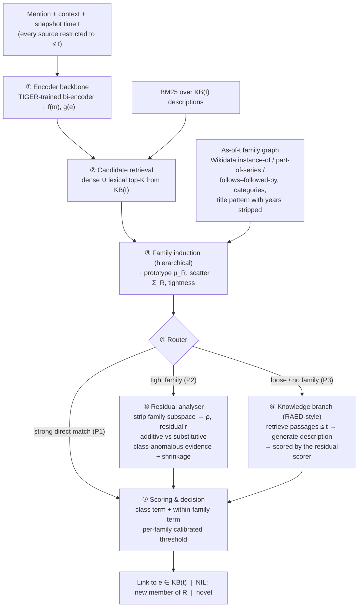

# Linking Emerging Entities by Family and Residual — Research Proposal

**Benchmark:** TempEL (Zaporojets et al., NeurIPS 2022 D&B)
**Compared against:** TempEL bi-encoder (BLINK-style), TIGER (Zhang, Cao, Groth 2024), CYCLE (CIKM 2024), RAED (Ghonim et al., EMNLP 2025)
**Status:** working design. No implementation yet, and no performance estimates. Every number below is quoted from a paper and the source is given.

> **How this document was made.** It combines two earlier drafts: `emerging-entity-linking-research-ideation.md` and `MYexplaination.md` (the idea presented to the professor). **Neither draft is a commitment.** Where they agree, the idea stays. Where they disagree, the paper evidence decides. Factual errors in either draft are corrected in §3.5, not carried over.

---

## 0. Summary

TempEL shows that newly emerging entities lose far more accuracy over time than continual ones (up to 17.9 vs 3.1 accuracy@64 points). But TempEL's own analysis shows that roughly 90% of these "new" entities are **new members of a family that already exists**: the next edition of a recurring event, or a page split off from an older one. In these cases, what identifies the entity is a small **residual**: a year, a host, a team list, a winner. A standard bi-encoder encodes each entity as one vector from its stub description and scores it with one dot product, which gets lost in the shared family content. Graph methods (TIGER, CYCLE) sharpen the embedding space in general, but they plateau on new entities. Retrieval-augmented description generation (RAED) helps with genuinely novel concepts like COVID-19, but it still picks the answer by cosine similarity against near-identical sibling descriptions.

> **Thesis.** Most emerging entities in TempEL are new members of existing families, so they should be linked by *what distinguishes them from their family*, not by a standalone embedding. Graph methods like TIGER do the opposite and average them toward their siblings.

**One core claim, three extensions.** The core contribution is **family-relative scoring**: represent and score a new entity as its family prototype plus a residual, not as a standalone vector. Everything else is an extension built on that core and can be ablated separately: typing the residual (added facts vs changed values), a per-family "not in the knowledge base" answer, and routing novel entities to a knowledge branch.

In more detail, we propose to link a mention in three steps: **(1)** find its *family* (a prototype of similar entities, organised as a hierarchy), **(2)** strip away what the family has in common and study the *residual*, and **(3)** decide from the kind of residual whether the mention refers to an existing entity that was updated, a sibling, or something the family cannot explain. The third case is routed to a RAED-style knowledge branch. The plain bi-encoder is a special case of the model (§4.3), so every component can be ablated cleanly.

---

## 1. Motivation: what TempEL shows

### 1.1 The dataset

TempEL is built from 10 yearly English-Wikipedia snapshots, 2013–2022, taken from a February 2022 history dump. It separates two kinds of entities:

- **Continual entities** exist in every snapshot. Their descriptions and the contexts that mention them change over time. Each split has 10,000 of them.
- **New entities** are first created inside a given snapshot year. Each split has 373 of them. The new-entity anchor mentions number **1,764 / 1,231 / 1,450** (train / val / test) per snapshot.

The model is a BLINK-style bi-encoder, and the metric is accuracy@64.

### 1.2 Findings that motivate this work

| # | Finding (TempEL paper) | What it tells us |
|---|---|---|
| F1 | Over time, continual entities lose **up to 3.1** accuracy@64 points; new entities lose **up to 17.9**. | Temporal degradation hits emerging entities hardest. |
| F2 | In a manual check of 100 new entities, **~68%** were recurring events (e.g. "2018 BNP Paribas Open") and **~22%** were extracts of already existing pages. | About 90% of "new" entities are born into an **existing family**. The paper expects them to "require little additional knowledge." |
| F3 | In 2021, COVID-19 entities make up **24%** of new entities and are linked by **30%** of mentions. They take an extra **~14** accuracy@64-point penalty compared with other new entities. | A second, different population: entities that need **genuinely new world knowledge**. |
| F4 | Changes to continual entities are **accumulative**: later descriptions keep the old information and add new facts (e.g. a soccer *player* becomes a *coach*). | When an existing entity changes, the change looks like *addition*, not replacement. We use this directly in §3.2. |
| F5 | The Jaccard similarity between the top-64 retrieved candidates **rises every year**, while the number of Wikipedia entities keeps growing (TempEL Fig. 4a, 4c). | The candidate space gets **more crowded**. More entities sit closer together. |
| F6 | The words around mentions drift **more** than the entity descriptions themselves (TempEL Fig. 3c). | The mention side matters too. We address this only partly (§5). |
| F7 | Fine-tuning on the same snapshot helps new entities more than continual ones, and the effect is concentrated in the COVID subset (Fig. 5c). | The two new-entity populations (F2 and F3) respond to **different interventions**. |

**A correction that makes the argument stronger.** "Emerging entities are harder" is true for *degradation* (F1). It is **false for TempEL's absolute accuracy**: new entities score *higher*. In the 2013 cell, new entities reach 0.910 accuracy@64 against 0.785 for continual ones, and the paper says so explicitly. That result is what F2 predicts. Most new entities are near-duplicates of known ones, so the right candidate usually lands somewhere in the top-64, yet it is hard to put at rank 1. The problem is **discrimination inside a family**, not missing knowledge.

### 1.3 Why current fixes stall

**TIGER** uses graphs during training to shape how the bi-encoder represents entities. It uses two graphs: a *structure graph* built from Wikidata5M relations, and a *feature graph*, which is a kNN graph over the embeddings of entity descriptions. Shared and distinct GCN branches, trained with a consistency loss and an HSIC loss, act as regularisers on the encoder. Two problems remain for emerging entities:

1. **The structure graph is from July 2019** (as the TIGER paper states). An entity created after that date has *no* edges in it. TIGER's own Figure 6 shows that its gains grow with node degree, so new entities sit at the worst end of that curve.
2. **The feature graph pulls a new entity toward its siblings.** For "2021 FAI Cup", the nearest descriptions are the 2020 and 2019 editions. Graph convolution averages the entity with those neighbours. The entity's identity lives in how it *differs* from its siblings, so this averaging moves it the wrong way. This is the "averaging" concern raised in the earlier explanation, placed where it actually happens.

**The plateau.** Recall@1 on new entities at a 3-year train/test gap:

| Model | R@1, new entities, gap = 3 | Source |
|---|---|---|
| BLINK | 0.142 | TIGER Table |
| SpEL | 0.192 | TIGER Table |
| TIGER | 0.217 | TIGER Table |
| CYCLE | 0.222 | CYCLE paper, as reported in the ideation doc (paper not in `Papers/`) |

CYCLE replaces TIGER's graph mechanism with cross-year graph contrastive learning and is explicitly designed for low-degree entities. On new entities it is within half a point of TIGER. **Changing the graph mechanism doesn't move new-entity accuracy.**

> *Caveat (TempEL-Dx, inferred and not yet verified):* the split sizes in TIGER's Table 1 suggest that its "New Entities" setting may train on new-entity mentions but test on a pooled set that is about 97% continual-entity mentions. This must be checked against the Graph-TempEL release before any comparison is published.

**RAED** retrieves Wikipedia passages and generates a title and definition for the mention. When TempEL's 2019 model is applied to the 2020 / 2021 / 2022 test sets, RAED raises accuracy@64 on emerging entities from 51.2 / 37.8 / 44.5 (T5 without retrieval) to **57.0 / 47.4 / 53.5**. Gold Wikipedia descriptions reach **71.0 / 64.8 / 72.3**, so there is still a lot of headroom. RAED is the right tool for F3-type entities, with two limits:

1. **It picks the answer by cosine similarity** between the generated description and each candidate description. A faithful description of the 2021 edition is cosine-close to *every* edition. Writing a *faithful* description is not the same goal as writing one that *separates* the entity from its siblings.
2. **Its index is not temporally sound.** It is built from a January 2023 dump, and TempEL-Dx lists five ways information can leak into it.

---

## 2. Problem statement

### 2.1 Task

Input: a mention $m$ with its left and right context, observed in snapshot $t$, and the knowledge base $\mathrm{KB}(t)$ as it existed at $t$. The goal is to output the entity $e \in \mathrm{KB}(t)$ that $m$ refers to. This is the closed-world setting TempEL uses. As an open-world extension, the model may instead answer **NIL**: "a new member of family *R*, not yet in the KB" (evaluation setup in §6.4). An **emerging entity** is one created in the interval $(t-1, t]$. Nothing dated after $t$ may be used (§6.3).

### 2.2 Three populations with different failure modes

| | Population | Share in TempEL | What goes wrong | Kind of problem |
|---|---|---|---|---|
| **P1** | Continual entities whose text has drifted | 10,000 entities / split | The description changed, but the identity did not. | Drift (mostly handled; must not regress) |
| **P2** | New members of a dense family (recurring events, page extracts) | ~90% of new entities (F2) | The gold entity is in the candidate list but loses to a sibling that looks almost the same. | **Discrimination** |
| **P3** | Genuinely novel entities (COVID-19) | 24% of 2021 new entities (F3) | Neither the encoder nor the stub carries the needed knowledge. | **Knowledge** |

### 2.3 The core problem

> A single description vector per entity, scored with a single dot product, cannot separate a new family member from its siblings. The information that identifies it is a small **residual** (year, host, teams, winner) sitting inside a large block of content the family shares. Also, no current system decides **which** mechanism a mention needs: discrimination for P2, or knowledge injection for P3. Graph methods treat everything as P2-like, and RAED treats everything as P3-like.

### 2.4 Research questions

- **RQ1 (diagnosis).** On TempEL's emerging subset, what share of errors are *within-family confusions*, what share are *retrieval failures* (gold not in the top-K), and what share are *knowledge failures*? No published work reports this breakdown.
- **RQ2 (discrimination).** Does scoring with a family prototype plus a residual reduce the sibling-confusion rate on P2 compared with BLINK and TIGER?
- **RQ3 (routing).** Can family tightness decide when to send a mention to RAED-style knowledge injection (P3), and does routing beat applying one mechanism to every mention?
- **RQ4 (safety).** Does all of this avoid hurting continual entities (P1)?

---

## 3. The idea

### 3.0 Core claim and extensions

| | Contribution | Stands on its own? |
|---|---|---|
| **Core** | **Family-relative scoring.** Score a mention against a candidate as *which family?* plus *which member, relative to the family prototype?* (§4.3). The family is found at linking time, from the candidate list and as-of-$t$ relations, so it works for entities that have no training data at all. | Yes. This is the paper's main claim and the first thing to build. |
| Ext. 1 | **Residual typing**: added facts (the same entity, updated) vs changed values (a sibling) (§3.2) | Needs the core |
| Ext. 2 | **Per-family "not in the knowledge base" answer**: "new member of family *R*" (§6.4) | Needs the core and Ext. 1 |
| Ext. 3 | **Routing** novel entities (loose or no family) to a RAED-style knowledge branch | Needs the core's family tightness |

If an extension does not help, the paper still stands on the core. If the core does not help, the extensions don't matter (§7).

### 3.1 Intuition: find the family, then read the residual

For each mention, ask three questions in order:

1. **Which family does it belong to?** Retrieve candidates and group them into a family, which can be hierarchical. The family's average representation is its **prototype**.
2. **How tight is the family?** A tight family, where members share most of their content, means the answer turns on a residual. A loose family, or no family at all, means the concept itself may be unknown.
3. **What is left after removing what the family shares, and what kind of difference is it?**

**Example A: "FIFA World Cup 2026".**
Family: *Football → FIFA World Cup*, which is tight. Its nearest members are *2022 FIFA World Cup* and *2018 FIFA World Cup*. After removing the shared content, a large share of the description is common (say ~80%; the number is only illustrative). The remaining differences are **values in the same slots**: year, host, teams, squads, winner. So the entity is a **sibling** of 2022 and 2018: a new member of the series, not an update of any existing edition. It *continues the series* without being the *same entity* as an earlier edition.

**Example B: a newly created international football tournament.**
Family: *Football*. Inside that family it has no close match. At the level above, it sits next to *FIFA World Cup*, *UEFA Euro*, and so on. It is a **sibling at the tournament level**, and nothing at the edition level explains it.

**Example C: "COVID-19" in a 2021 context.**
The retrieved candidates share little with each other (e.g. "coronavirus", "SARS", "pandemic"), so the family is **loose**. Removing a prototype explains little of the mention. The model detects this and routes the mention to the knowledge branch (RAED-style retrieval and generation).

### 3.2 The decision rule, made precise

Let $\rho$ be the **shared share**: how much of the mention's representation the family prototype explains. Let $r$ be the **residual** left after removing the family subspace. Compare the mention's residual with the residual of each family member:

| Observation | Interpretation | Action |
|---|---|---|
| Residual is **additive**: the same slots have the **same values**, and new facts are only appended | Same entity, updated. TempEL finding F4: continual changes accumulate. | Link to that existing entity (P1) |
| Residual is **substitutive**: the same slots have **different values** (year, host, teams, winner) | **Sibling**, a different member of the family | Link to the sibling whose residual matches, if it is in $\mathrm{KB}(t)$. Otherwise answer NIL, "new member of family *R*" (P2) |
| $\rho$ is low for every candidate family, or the family is loose | The concept is not explained by any known family | Route to the knowledge branch (P3) |

**How "added vs changed" is measured.** Embeddings have no slots like "year" or "host", so the test runs on **structured facts as of $t$**, not on vectors:

1. **Slot comparison (primary).** For the candidate and each family member, take the Wikidata statements and infobox fields as they stood at $t$: property → value, e.g. `point in time`, `country`, `winner`, `participating team`, `edition number`, `follows / followed by`.
   - Same property, **different value** (2026 vs 2022, United States vs Qatar) → **substitutive** → sibling.
   - Existing values **unchanged**, only **new properties or values appended** → **additive** → same entity.
   - The share of matching (property, value) pairs gives a structured version of the shared share $\rho$.
2. **Text diff (fallback).** For entities with few statements, which is common for stubs, compare the as-of-$t$ description with the member's description. Replaced spans (numbers, years, names in the same sentence position) count as substitutive, and appended sentences count as additive. This follows TempEL finding F4.
3. **Embedding residual (tie-break only).** The vector residual $r$ is used only when 1 and 2 cannot decide.

The typing is fixed rules (no learning), so it adds no training data needs and can be audited by hand.

Why keep the additive-versus-substitutive test: it comes from the earlier explanation, and TempEL independently supports it (F4). It also gives the NIL decision a concrete basis. A plain similarity threshold cannot tell "an updated version of X" from "the next X", because both are highly similar to X.

### 3.3 What the two drafts contributed

| Kept from | Idea |
|---|---|
| Both | Family/prototype, then residual, then routing between a discrimination route and a knowledge (RAED) route |
| `MYexplaination.md` | Hierarchical families (Football → FIFA World Cup); the shared-share $\rho$; additive vs substitutive residual (same entity vs sibling) |
| Ideation doc | Within-family whitening; shrinkage toward the prototype when evidence is thin; weighting evidence by how unusual it is for the family; NIL thresholds calibrated per family; the evaluation and falsification plan |

### 3.4 How this differs from the nearest prior work

| Nearby work | What it does | How we differ |
|---|---|---|
| **Hard-negative mining** | Trains with difficult negatives | We use siblings as negatives too (§4.4), but only as a training aid. The claim is about the *scoring function*: family-relative scoring at linking time. We report "sibling negatives only" as a control. |
| **Embedding whitening / LDA** | Removes directions shared across a global dataset or across known classes | Our "classes" are families found **at linking time, per mention**, including for entities with **zero training examples**. We report "whitening only on a frozen BLINK" as a control. |
| **TIGER / CYCLE** | Graph losses shape a global embedding space during training | They *smooth* an entity toward its graph neighbours. We use the same neighbours as a **contrast** at linking time. The post-2019 structure graph gives newborns no edges; our family graph is as of $t$. |
| **RAED** | Generates a description from retrieved passages, then picks by cosine | We use it only on the novel route, and we score its output relative to the family, not by raw cosine. |
| **EDIN** | Finds unknown entities by *clustering* similar mentions | Clustering by similarity is exactly what merges siblings. We ask the opposite question: what separates a new entity from the entities it most resembles? |
| **STAMO** | Learns linking features for out-of-KB entities from a few labelled documents | It needs labelled documents per entity and has no time bound. Our family statistics come from $\mathrm{KB}(t)$ with no labels. |
| **BLINKout** | A learned global "not in the knowledge base" entity | Its threshold is global. Ours is **per family**, because similarity scores are not comparable between dense and sparse families. |
| **DELICATE** | Re-ranks with type and temporal-plausibility features | It uses type information as a feature. It has no family-relative representation and no treatment of low-evidence newborns. |

### 3.5 Corrections to earlier drafts

1. **"90% of new entities are actually continual entities" is wrong.** They are recurring events (~68%) or page extracts (~22%). They are *new pages* that come *from existing families*. That is exactly why the family idea fits.
2. **TIGER does not enrich the mention.** It enriches *entity* representations with graph structure (Wikidata5M relations plus a description-kNN graph) **during training**. According to both earlier analyses, inference uses text only; the TIGER paper text did not confirm this directly, so check it in the code. The "averaging toward siblings" concern is real, and it comes from the kNN feature graph (§1.3).
3. **RAED** is retrieval-augmented *description generation*. Here it is one branch that is used only on the novel route. It is not the default pipeline.
4. **"Emerging entities are harder"** is true only for degradation, not for absolute accuracy@64 (§1.2).
5. **CYCLE** was missing from the earlier explanation. It is TIGER's direct successor, and its flat new-entity results are the main evidence that graph methods plateau.

---

## 4. The model and its architecture

Working name: **FamRes** (Family–Residual linker). The name is a placeholder.

### 4.1 Pipeline

### 4.2 Components

| # | Component | Input → output | Design choice and reason |
|---|---|---|---|
| ① | **Encoder backbone** | text → $f(m)$, $g(e)$ | Reuse a TIGER-trained bi-encoder. Its graph-shaped space is good for P1. Keeping the mention encoder unchanged means any gains can be attributed to steps ③–⑦. |
| ② | **Candidate retrieval** | $f(m)$ → top-K from $\mathrm{KB}(t)$ | Dense retrieval plus a BM25 leg. Lexical retrieval needs no training, is free of temporal leakage when its IDF is computed on the as-of corpus, and catches surface cues such as years and edition numbers. |
| ③ | **Family induction** (the graph-based part) | candidates + as-of-$t$ graph → family $R$, prototype $\mu_R$, scatter $\Sigma_R$, tightness | The top-K list already approximates the family: a query for the 2026 edition returns 2022 and 2018. Sharpen it with typed relations valid at $t$ (instance-of, part-of-series, follows/followed-by), categories, and title patterns with years and ordinals stripped. Build it as a hierarchy (Football → FIFA World Cup). **Unlike TIGER, the graph is used to find siblings to contrast against, not to average with.** |
| ④ | **Router** | class fit, tightness, margins → one route | P1: one candidate matches directly with a clear margin. P2: the family is tight. P3: no family explains the mention. The routing decision uses the same quantities as the scoring function, so it is not a separate module bolted on. |
| ⑤ | **Residual analyser** | $\mu_R$, $\Sigma_R$, evidence $\le t$ → residual estimate $\hat{e}$ | Remove the family subspace, compute $\rho$ and the residual, and classify the residual as additive or substitutive using as-of-$t$ slot comparison (§3.2). Weight evidence by how *unusual* it is for the family, not by how relevant it is to the mention. Relevance-ranked evidence mostly returns content the siblings share. Shrink toward the prototype when evidence is thin. |
| ⑥ | **Knowledge branch** | passages $\le t$ → generated description → vector | The RAED mechanism, used only on P3. Its output is scored by the residual scorer in ⑦, not by raw cosine, which fixes RAED's weakness with siblings. It uses a temporally sound index (§6.3). |
| ⑦ | **Scoring and decision** | $f(m)$, $\hat{e}$, $\mu_R$, $\Sigma_R$ → link / NIL / novel | Two terms: *which family?* and *which member?* (§4.3). The NIL threshold is calibrated **per family**, because raw similarity cannot be compared across dense and sparse families. |

**Core vs extensions (§3.0).** The core is ① + ② + ③ + the two-term score in ⑦. Residual typing in ⑤ is Ext. 1, the NIL answer in ⑦ is Ext. 2, and the router ④ with the knowledge branch ⑥ is Ext. 3. Build and evaluate the core first.

### 4.3 Formulation

**Family statistics** (over the family members $R(e,t)$ in $\mathrm{KB}(t)$):

$$
\begin{aligned}
\mu_R &= \text{mean of } g(d_{e'}) \text{ for } e' \in R, \qquad \Sigma_R = \text{within-family scatter} \\
g(d_e) &= \mu_R + r_e, \qquad r_e = \text{the individuating residual} \\
\rho &= \text{share of } \lVert g(d_e) \rVert^2 \text{ explained by the family subspace}
\end{aligned}
$$

**Evidence weighting and shrinkage** (entity representation at birth, from few observations):

$$
\begin{aligned}
w(v) &\propto \exp\left(\frac{\lVert P_R\, \psi(v) \rVert}{\tau}\right), \qquad P_R = \Sigma_R^{-1/2}\left(I - \hat{\mu}_R \hat{\mu}_R^{\top}\right) &&\text{how unusual evidence } v \text{ is for the family} \\
n_{\text{eff}} &= \sum_v w(v) \\
\hat{e} &= \mu_R + \frac{n_{\text{eff}}}{n_{\text{eff}} + \lambda}\, \hat{r}_e &&\text{thin evidence} \Rightarrow \text{stay near the prototype}
\end{aligned}
$$

**Factored score:**

$$
s(m, e) = \underbrace{\beta \cdot \langle f(m), \hat{\mu}_R \rangle}_{\text{which family?}}
        + \underbrace{\left(f(m) - \mu_R\right)^{\top} \Sigma_R^{-1} \left(\hat{e} - \mu_R\right)}_{\text{which member?}}
$$

**Decision:**

$$
\begin{cases}
\text{link} & \text{if the best within-family margin} > q_R(\alpha) \quad \text{(per-family calibrated)} \\
\text{NIL} \rightarrow \text{new member of } R & \text{if the family fits but no member clears } q_R(\alpha) \\
\text{novel} \rightarrow \text{knowledge branch} & \text{if no family fits}
\end{cases}
$$

**The baseline is nested inside the model.** Setting $\Sigma_R = I$, $\mu_R = 0$ and $\lambda = 0$ gives back the plain bi-encoder dot product. Each ablation removes exactly one assumption. The shrinkage factor $\frac{n_{\text{eff}}}{n_{\text{eff}} + \lambda}$ also predicts the shape of the accuracy-versus-evidence curve, which can be checked.

### 4.4 Training

- **Backbone:** a TIGER-trained bi-encoder, used as released.
- **Fine-tuning:** use **family-member (sibling) hard negatives** instead of random in-batch negatives. Random in-batch negatives almost never include the gold entity's sibling, so the model never learns the axis that matters for P2.
- **Hyper-parameters:** tune $\beta$, $\lambda$, $\tau$ and the per-family thresholds $q_R$ on validation.
- **Small training set:** only 1,764 new-entity training mentions per snapshot. That is enough, because the family statistics come from $\mathrm{KB}(t)$ itself, not from labelled mentions.

---

## 5. Mapping TempEL's problems to our components

| TempEL problem / finding | Why current systems fail on it | Component that addresses it |
|---|---|---|
| **F1** New entities degrade 17.9 vs 3.1 points | The entity vector is one noisy estimate from a young stub | ③ family prototype + ⑤ residual with shrinkage |
| **F2** ~68% recurring events, ~22% page extracts | Siblings are nearly identical in text, and one dot product is dominated by family content | ③ family induction + ⑤ **substitutive residual → sibling** + ⑦ within-family term |
| **F3** COVID-19 (2021): 24% of entities, 30% of mentions, extra ~14-point penalty | The knowledge is absent from both the encoder and the stub | ④ router → ⑥ **knowledge branch** (RAED-style) |
| **F4** Continual changes accumulate | Drift can be mistaken for a new entity | ⑤ **additive residual → same entity** → link (P1) |
| **F5** Top-64 candidates become more similar over time, and the KB keeps growing | A fixed global space gets crowded | ⑦ **within-family whitening** $\Sigma_R^{-1}$ removes directions the family shares |
| **F6** Mention context drifts more than entity descriptions | Almost all temporal EL work acts on the entity side | Partly: ② BM25 leg. **Not a main target and listed as a limitation.** |
| **F7** New entities and COVID respond to different interventions | One mechanism is applied to every mention | ④ **routing** between ⑤ and ⑥ |
| Only 1,764 new-entity training mentions per snapshot | Cannot learn new entities from labels | Statistics come from $\mathrm{KB}(t)$; shrinkage is built for few samples |
| Closed-world benchmark, no NIL | Forced to pick a wrong entity | ⑦ **per-family calibrated NIL** ("new member of family R") |
| *(TIGER)* Post-2019 entities have no structure-graph edges, and the kNN graph smooths toward siblings | The graph signal is missing, or points the wrong way | ③ **as-of-t** family graph used for **contrast, not smoothing** |
| *(RAED)* Cosine against sibling descriptions; 2023 index | A faithful description is not a separating one; information leaks | ⑥ output scored by the residual scorer; index restricted to $\le t$ |
| *(All)* Tuned for aggregate accuracy only | Cannot tell which failure mode dominates | §6.1 diagnosis first, and sibling-confusion rate as a primary metric |

---

## 6. Evaluation plan (short)

The full design is in ideation doc §13–16 and in `TempEL-Dx`.

### 6.1 Diagnosis before building (stop-or-go gate)

Reproduce BLINK/TempEL and TIGER, then label every emerging-entity error:

- gold **not in the top-64**: retrieval failure
- gold in the top-64, and the prediction is **in the gold's family**: within-family confusion (the hypothesis)
- gold in the top-64, and the prediction is unrelated to the gold: another representation failure
- gold is a stub, or belongs to the novel population: knowledge failure

**If within-family confusion is a small share, stop and change direction** (for example to retrieval, or to the protocol paper in §7).

### 6.2 Metrics, slices and baselines

- **Metrics:** accuracy@64 (comparable with TempEL and RAED); R@1 and MRR (comparable with TIGER and CYCLE, and where discrimination shows); **sibling-confusion rate**, which tests the mechanism; NIL precision/recall/F1; ECE and risk–coverage.
- **Slices:** new vs continual; family density; derivative vs novel; stub vs developed description; graph degree at $t$; train/test gap of 0–3 years; the 2021 COVID subset reported separately.
- **Baselines, rerun on the same splits:** BLINK/TempEL, SpEL, TIGER, CYCLE, RAED descriptions placed in the TempEL index, and BLINKout for NIL.
- **Controls:** *whitening only* on a frozen BLINK; *sibling hard negatives only*.
- **Ablations:** remove whitening; remove residual typing; use relevance-ranked instead of anomaly-ranked evidence; $\lambda = 0$; remove routing (always ⑤ or always ⑥); oracle family.

### 6.3 Strict temporal protocol

Everything used at test time must be dated **$\le t$**: the KB inventory and descriptions, graph edges, passages, aliases and redirects. **Any LLM whose pretraining data extends past $t$ is reported only as a contaminated oracle.** Declare whether evaluation is inductive or transductive. Build the passage index per year from the same revision history TempEL uses.

---

### 6.4 Making "new member, not in the knowledge base" testable

TempEL is closed-world: the gold entity is always in $\mathrm{KB}(t)$, so the answer "new member of family *R*" can never be correct on it. To evaluate Ext. 2 we add an open-world setting, built the way BLINKout builds its evaluation (by removing entities from the knowledge base):

- **Hidden-gold mentions.** For each new-entity test mention, remove its gold entity from $\mathrm{KB}(t)$. The correct answer becomes NIL, *with the family label kept* (e.g. "new member of FIFA World Cup"). Siblings stay in the knowledge base, so this is the hard case: a very similar entity is always available as a wrong answer.
- **Kept-gold mentions.** The same mentions with the gold left in $\mathrm{KB}(t)$, and correct answer = the gold. This checks that the model does not over-predict NIL.
- **Continual controls.** Continual-entity mentions with the gold kept. Predicting NIL here is always wrong.
- **Metrics.** NIL precision / recall / F1; accuracy of the family label on NIL predictions; AUROC for in-KB vs NIL. Report all of these separately for kept-gold and hidden-gold mentions.
- **Baselines.** BLINKout's global NIL threshold, and a global threshold on TIGER scores. The claim to test is that **per-family** thresholds beat a single global one.

Leave-one-out removal is simpler than TempEL-Dx's red-link NIL items, and it can be built from TempEL's current splits without new annotation. TempEL-Dx's red-link items are the more realistic follow-up.

## 7. Risks and falsifiers

- **Errors turn out to be retrieval-bound** (the gold entity is usually not in the top-64). Then representation work is beside the point; move to better retrieval or to RAED-style bypass of the inventory.
- **Errors are scattered, not within families.** Then there is no residual structure to exploit.
- **Anomaly-based evidence selection performs the same as relevance ranking.** Then what remains is hard-negative mining with extra steps.
- **The tuned $\lambda$ collapses to $0$ or $\infty$.** Then the shrinkage story collapses too.
- **Wrong family induced**, so whitening happens in the wrong subspace. This should show up as a bimodal error distribution.
- **Small families make $\Sigma_R$ ill-conditioned.** Pool the covariance across families and report condition numbers.
- **Continual entities regress.** Report P1 results in every table.
- **Fallback paper, useful in every case:** a temporally sound index and protocol, a diagnosis of error causes for BLINK, TIGER, CYCLE and RAED, and a re-evaluation of prior gains (see `TempEL-Dx`).

---

## 8. References

- Zaporojets et al. *TempEL: Linking Dynamically Evolving and Newly Emerging Entities.* NeurIPS 2022 Datasets & Benchmarks. — `Papers/NeurIPS-2022-tempel-…pdf`
- Zhang, Cao, Groth. *TIGER: Temporally Improved Graph Entity Linker.* 2024. — `Papers/TIGER Temporal EL-1.pdf`
- Zhang et al. *CYCLE: cross-year graph contrastive learning for temporal EL.* CIKM 2024. (not in `Papers/`)
- Ghonim et al. *RAED: Retrieval-Augmented Entity Description Generation for Emerging Entity Linking and Disambiguation.* EMNLP 2025. — `Papers/2025_REtrieval_…pdf` (and `Papers/new entity.pdf`, a second copy with different page numbers; check the ACL Anthology before citing)
- Wu et al. *BLINK: Scalable Zero-shot Entity Linking with Dense Entity Retrieval.* EMNLP 2020.
- BLINKout (CIKM 2023), EDIN (EMNLP 2022), STAMO (TKDE 2023): open-world and emerging-entity prior art.
- *TempEL-Dx: A Diagnostic, Temporally-Correct Benchmark for Emerging-Entity Linking.* Internal design doc, Sep 2026. — `Papers/TempEL-Dx …pdf`
